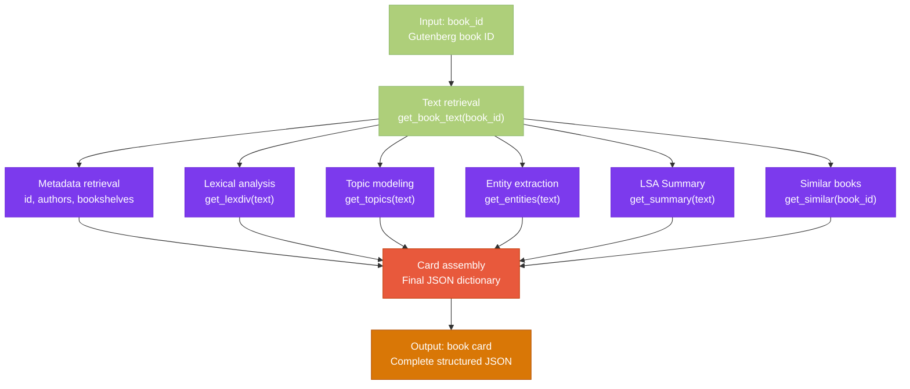

# Pipeline of Book Card

---

## Step descriptions

1. **Input** : The program receives a `book_id` corresponding to a book from the Project Gutenberg catalog.
2. **Text retrieval** : The raw text is downloaded from Gutenberg via `get_book_text()`, cleaned of Gutenberg headers/footers, then cached locally in `./storage/`.
3. **Metadata retrieval** : Basic book information (id, authors, categories) is fetched. The subject requires the fields `id`, `authors` and `bookshelves` in the `info` section of the card.
4. **Lexical analysis** : `get_lexdiv()` computes lexical diversity metrics: total word count (tok), unique words (typ), hapax legomena (hap), type/token ratio (ttr), mean word length (mwl) and mean word frequency (mwf).
5. **Topic modeling** : `get_topics()` splits the text into sections (chapters), then extracts the 10 most representative words from each section using TF-IDF.
6. **Entity extraction** : `get_entities()` uses spaCy to identify characters (PERSON) and locations (GPE, LOC) mentioned in the book.
7. **LSA Summary** : `get_summary()` generates an extractive summary of 5 sentences using Latent Semantic Analysis (Sumy).
8. **Similar books** : `get_similar()` compares the target book against the 20 others in the catalog using TF-IDF + cosine similarity and returns the 5 closest matches.
9. **Card assembly** : All analyses are gathered into a single JSON dictionary following the format required by the subject.
10. **Output** : The complete card is displayed as structured JSON.
