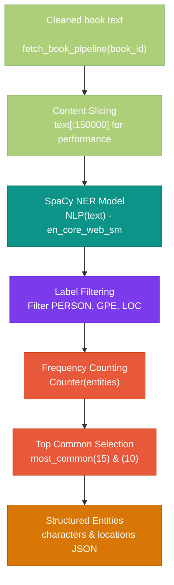

---

### Named Entity Recognition Pipeline (`--entities`)
This pipeline utilizes a pre-trained Deep Learning model to extract real-world concepts from the narrative.

* **Contextual Analysis**: The `en_core_web_sm` model performs a dependency parse to understand the grammatical context of every sentence.
* **NER Classification**: The model identifies "Named Entities" and assigns them categories based on linguistic patterns.
* **Label Filtering**:
    * **PERSON**: Extracted to identify characters.
    * **GPE / LOC**: Extracted to identify countries, cities, or geographic landmarks.
* **Frequency Aggregation**: Occurrences are counted to distinguish between main protagonists/settings and minor mentions.
* **Selection**: The pipeline returns the top 15 characters and top 10 locations, providing a structured overview of the book's world.
