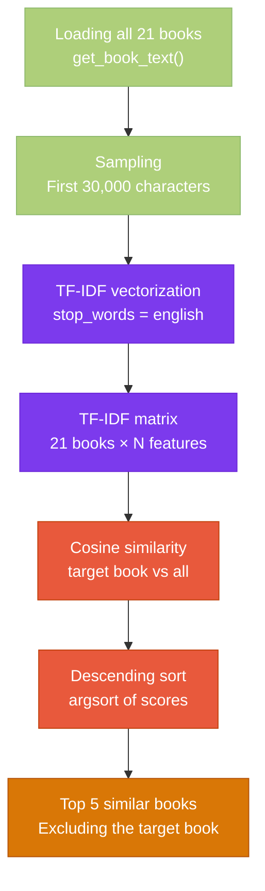

# Pipeline of similar

---

## Step descriptions

1. **Loading all 21 books** : The program retrieves the text of each of the 21 books in the catalog via `get_book_text()`. Each book is downloaded from Project Gutenberg, cleaned of Gutenberg headers and footers, then cached locally in `./storage/` to avoid re-downloading.
2. **Sampling** : For performance reasons, only the first 30,000 characters of each book are kept. This is enough to capture the main style and vocabulary of the work without overloading memory or slowing down computation.
3. **TF-IDF vectorization** : Each book is transformed into a numerical vector via `TfidfVectorizer`. The TF-IDF weighting (Term Frequency - Inverse Document Frequency) gives a high weight to words that are frequent in a book but rare across the entire corpus, highlighting the distinctive vocabulary of each work. English stop words are excluded.
4. **TF-IDF matrix** : The result is a 21 × N matrix, where each row represents a book and each column a word from the vocabulary. Each cell contains the TF-IDF score of that word for that book.
5. **Cosine similarity** : The target book's vector is compared to all other vectors via `cosine_similarity()`. This metric computes the angle between two vectors: a score of 1.0 means identical vocabulary, 0.0 means nothing in common.
6. **Descending sort** : The similarity scores are sorted from highest to lowest via `argsort()[::-1]`, placing the most similar books first.
7. **Top 5 similar books** : The 5 books with the highest scores are selected (excluding the target book itself). The list is returned sorted by decreasing similarity.