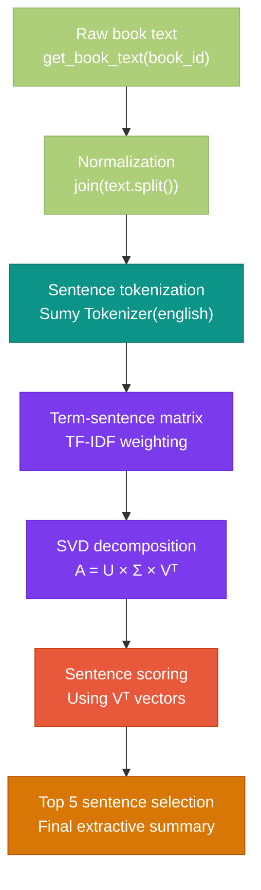

# Pipeline of summarize

---

## Step descriptions

1. **Raw text** : Retrieved and cleaned from Project Gutenberg.
2. **Normalization** : Multiple spaces and line breaks are merged into single spaces.
3. **Tokenization** : The text is split into sentences using `Tokenizer("english")` and `PlaintextParser`.
4. **Term-sentence matrix** : Each sentence is converted into a TF-IDF vector.
5. **SVD decomposition** : The matrix is decomposed into `U × Σ × Vᵀ` to extract latent concepts.
6. **Scoring** : Each sentence receives a score based on its contribution to the main concepts.
7. **Selection** : The top 5 sentences form the extractive summary.
