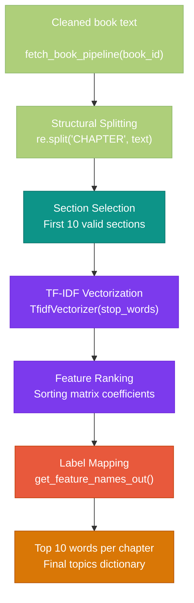

---

### Topic Modeling Pipeline (`--topics`)
This pipeline identifies the thematic essence of different sections of the book using statistical weighting.

* **Structural Segmentation**: The text is split into chapters using Regular Expressions (matching "CHAPTER" patterns). To optimize performance, the first 10 significant sections are selected.
* **Noise Reduction**: "Stop words" (common functional words like *the, a, is, of*) are filtered out as they carry no semantic weight.
* **TF-IDF Vectorization**: The system calculates the **Term Frequency-Inverse Document Frequency** score. This highlights words that are frequent within a specific chapter but unique relative to the rest of the book.
* **Feature Ranking**: Within each section, terms are ranked by their TF-IDF weight in descending order.
* **Thematic Extraction**: The top 10 highest-scoring terms per chapter are extracted to represent the "Topics" of that section.
